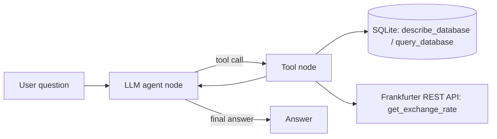

# Agentic AI Data Assistant (LangGraph + Tool Calling)

A multi-step AI agent that answers business questions by **reasoning across tools**:
a read-only **SQL database tool** and a live **REST API** (currency exchange rates).
Example: *"Convert total completed revenue to EUR at today's rate"* → the agent inspects the schema,
writes SQL, calls the FX API, then combines both results.

## Architecture



| Component | Purpose |
|---|---|
| `agent/graph.py` | LangGraph state machine (agent ⇄ tools loop, conversation memory) |
| `agent/tools/db_tool.py` | Schema + SELECT-only SQL (validator **and** read-only connection) |
| `agent/tools/api_tool.py` | Exchange-rate REST tool with timeout + error handling |
| `agent/logging_utils.py` | JSONL logs of every tool call, latency and token usage |
| `eval/` | Evaluation set with ground truth computed live from the DB/API |
| `LLM_PROVIDER` | Switch between Google Gemini (free tier) and Anthropic Claude in `.env` |
| `tests/` | Unit tests for tool safety (write attempts must be rejected) |

## Quick start

```bash
python -m venv .venv && source .venv/bin/activate
pip install -r requirements.txt
cp .env.example .env            # add a free GOOGLE_API_KEY (or an ANTHROPIC_API_KEY)
python -m data.seed_db          # builds data/sales.db (600 synthetic orders)
python main.py                  # chat with the agent
pytest                          # tool tests (no API key needed)
python -m eval.run_eval         # run the evaluation
```


